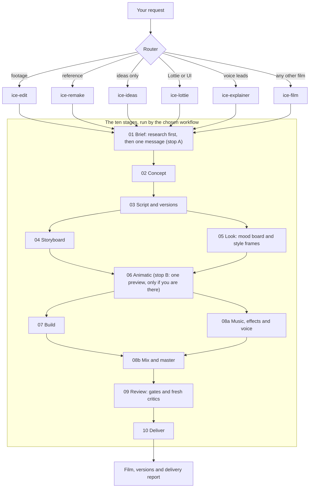
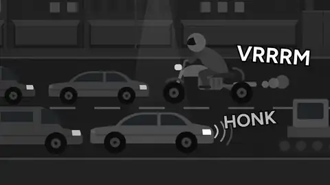

<p align="center">
  
</p>

<h1 align="center">Ice Motion Director</h1>

<p align="center">
  <b>A motion design and video editing director for your coding agent.</b><br>
  Describe a film, hand it your footage, or show it a reference. It plans, decides, writes the film as code, renders it and checks it before you see it.
</p>

<p align="center">
  <a href="https://ice-motion-director.omarhassan.workers.dev/"></a>
  <a href="LICENSE"></a>
  <a href="#install"></a>
  <a href="#install"></a>
  <a href="skills/ice-arabic"></a>
</p>

<p align="center">
  <a href="https://ice-motion-director.omarhassan.workers.dev/">Website</a> ·
  <a href="#install">Install</a> ·
  <a href="#try-it">Try it</a> ·
  <a href="#workflow-step-by-step">Step by step</a> ·
  <a href="#how-it-works">How it works</a> ·
  <a href="#skills">Skills</a> ·
  <a href="#gallery">Gallery</a> ·
  <a href="#privacy-and-network">Privacy</a> ·
  <a href="CREDITS.md">Credits</a>
</p>

---

## What it does

Ice Motion Director is an open-source set of agent skills for motion graphics, motion design and video editing in Claude Code, Codex, Cursor, Gemini CLI and 40+ other coding agents. You describe the video in one prompt (or hand it your footage, or a reference), and your agent takes it from the brief and the script to a rendered MP4, writing every frame as code and checking it before you see it. It is free under Apache-2.0 and needs no After Effects and no paid video model.

One router skill reads your request and sends it to the right workflow:

| You ask for | It runs | You get |
|---|---|---|
| A film made from scratch: launch film, app ad, brand film, logo sting, kinetic type, data story, social short | `ice-film` | A finished MP4 plus a delivery report |
| A video where a voice explains something | `ice-explainer` | A narrated explainer with captions |
| "Make it like this" with a reference video, site or images | `ice-remake` | A new film in that style, with your content |
| An edit of your own footage: YouTube, podcast clips, talking-head ads, shorts, news reels, B-roll | `ice-edit` | The cut, captions, vertical versions |
| Lottie, loaders, icons, UI motion for an app or site | `ice-lottie` | Lottie JSON or animated SVG plus a developer handoff |
| Ideas, hooks, scripts, storyboards | `ice-ideas` | A concept set and a script, ready to build |

Every film is code (HTML, CSS, GSAP, Remotion, Lottie or FFmpeg) and renders the same way every time. Nothing is generated as stock footage: text, numbers and logos are always set in code, exactly as you approved them.

## Two ways to use it

1. **One prompt, for everyone.** In Claude Code, start your first message with `/ice-motion-director:ice`, then describe the film in your own words, short or long. The command makes Claude Code load the director's instructions itself, so the run starts the right way even when other video skills are installed. A prompt without the command usually works too, but then the agent picks the skill on its own, which is not guaranteed. Other agents: see [how to type the commands](#how-to-type-the-commands). The director researches your business first, then asks about every decision your prompt leaves open: four options per question with the recommended one first, at most four questions per message, and more than one message when many decisions are open (including which official brand files it may use). It asks nothing when your prompt already covers everything, or when you say "don't ask" or "decide yourself". Then, only if you are there to answer, one preview: the style frames or the animatic. After that it runs to the final file with no more questions. Everything it decided is logged and explained in the delivery note.
2. **Step by step, for people who want to steer.** Run one stage at a time with numbered commands. In Claude Code the form that always works is `/ice-motion-director:ice-01-brief` to `/ice-motion-director:ice-10-deliver`. Each stage stops with a review card; talk it through, ask for changes or other options as often as you like. Say "approved" to lock the stage (it then names the next command), or "approved, go on" to lock it and start the next stage. See [Workflow, step by step](#workflow-step-by-step).

You can switch at any time: type a stage command in the middle of a one-prompt run, or `/ice` to let it finish the rest on its own.

> **What a first film takes.** From you: one prompt that starts with the command, then the questions on every open decision (four options each, at most four per message, none if your prompt covers everything or you say "don't ask") and, if you are there, one preview, where you also hear two or three real music options laid on the film and pick one. Behind it, your agent runs all ten stages with several helper agents, so even a short ad runs for a while and uses far more of your plan than a chat answer. If your agent hits a usage limit in the middle, type `/ice` (or send the same prompt) later: it resumes from `ice/state.json` where it stopped.

## Why it is different

- **The same professional floor for every prompt.** A one-line prompt gets the full process. A detailed brief or a design file gets the same quality and every spec you gave is obeyed. Prompt length only changes who makes each decision.
- **No two films look alike.** Each film starts with research dated today and built only from your brief, a pitch round with unexpected directions, and a check against your previous films and every bundled template. A film that drifts to the stock AI look (blue and purple everywhere, with no reason in the brief) fails its own gate.
- **Asks only what changes the film.** At most four short multiple-choice questions, the recommended answer first. Everything else is decided and logged with its reason.
- **Finds real material on its own.** For a real event, person or place it looks for the most recent real, official footage and photos and downloads them, and its music and sound effects are real recordings from libraries, matched to your reference or your kind of film. You never have to ask for any of this in your prompt: your prompt is the idea and your files.
- **The builder never grades itself.** Separate critic roles review storyboards, frames, motion, sound and the exported file. Every claim in the delivery report comes with measured numbers.
- **Arabic and right-to-left are first class.** Letterforms and dots in motion, kashida, bidi, numerals, Arabic captions and dialect as a setting.

## Install

**Any agent (Claude Code, Codex, Cursor, Gemini, Copilot, Windsurf, Cline, Roo, Kilo, OpenCode, Antigravity, Amp, Goose, Kiro, Qwen, Trae, Zed, Warp and more):**

```bash
npx skills add Omar-Tnzxo/ice-motion-director
```

It asks two things: which agents to install into, and whether to install for this project only or for every project on your computer (global). Keep every skill selected: the skills open each other, so picking only some breaks the run. Needs Node 22.20 or newer ([prerequisites](#prerequisites)).

Prefer no questions? Add flags:

| You want | Add |
|---|---|
| Every agent, every project, no questions | `-g --all` (the same as `-g -s '*' -a '*' -y`) |
| Only the agents you name | `-s '*' -a claude-code -a cursor` (one `-a` per agent) |
| Every project instead of this one | `-g` (without it, skills go into the current project) |
| Copies instead of links | `--copy` (for drives that cannot hold links, such as some network or USB drives; Windows itself needs no developer mode, links are made as junctions) |
| The list of agent names | Pass any unknown name, such as `-a help`: the tool stops and prints every valid name. |

**Claude Code plugin:**

```bash
claude plugin marketplace add Omar-Tnzxo/ice-motion-director
claude plugin install ice-motion-director@ice-motion-director
```

Inside a session: `/plugin marketplace add Omar-Tnzxo/ice-motion-director`, then `/plugin install ice-motion-director@ice-motion-director`.

<details>
<summary><b>Claude.ai and Claude Desktop</b></summary>

Open **Customize > Plugins > Add > Add marketplace** and enter `Omar-Tnzxo/ice-motion-director`. Turn on **Code execution and file creation** in **Settings > Capabilities** first. Update with **Check for updates** on the plugin page.

What works there: the brief, research, concepts, scripts and storyboards. Rendering needs a browser and FFmpeg on a computer, which the chat's code sandbox may not offer (not verified), so render the film with a local agent such as Claude Code.
</details>

<details>
<summary><b>Codex (CLI and app)</b></summary>

```bash
codex plugin marketplace add Omar-Tnzxo/ice-motion-director
codex plugin add ice-motion-director@ice-motion-director
```

Or run `/plugins` in Codex and install it from there, then start a new session. Update: `codex plugin marketplace upgrade ice-motion-director`. In the Codex app, use the **Plugins** tab.
</details>

<details>
<summary><b>Cursor</b></summary>

```bash
npx skills add Omar-Tnzxo/ice-motion-director -a cursor
```
</details>

<details>
<summary><b>Gemini CLI and Antigravity</b></summary>

```bash
gemini extensions install https://github.com/Omar-Tnzxo/ice-motion-director
agy plugin install https://github.com/Omar-Tnzxo/ice-motion-director
```

Update Gemini with `gemini extensions update ice-motion-director`; run the same `agy` command again to update Antigravity CLI. Antigravity app and IDE: `npx skills add Omar-Tnzxo/ice-motion-director -a antigravity`.
</details>

<details>
<summary><b>GitHub Copilot (CLI and VS Code)</b></summary>

```bash
copilot plugin marketplace add Omar-Tnzxo/ice-motion-director
copilot plugin install ice-motion-director@ice-motion-director
```

VS Code: Command Palette, **Chat: Install Plugin From Source**, paste `https://github.com/Omar-Tnzxo/ice-motion-director`. Update: `copilot plugin update ice-motion-director`.
</details>

<details>
<summary><b>Qwen Code</b></summary>

```bash
qwen extensions install Omar-Tnzxo/ice-motion-director
```

Update: `qwen extensions update ice-motion-director`.
</details>

<details>
<summary><b>Windsurf, Cline, Roo Code, Kilo Code, OpenCode, Amp, Goose, Kiro, Trae, Zed, Warp, Augment and others</b></summary>

```bash
npx skills add Omar-Tnzxo/ice-motion-director -a <agent>
```

Agent ids: `windsurf`, `cline`, `roo`, `kilo`, `opencode`, `amp`, `goose`, `kiro-cli`, `trae`, `zed`, `warp`, `augment`. Manual copy paths for every agent and every OS: [install matrix](docs/maintainers/install-matrix.md).
</details>

<details>
<summary><b>Windows notes</b></summary>

- Every command above works the same in PowerShell and cmd.
- If PowerShell says running scripts is disabled, use `npx.cmd skills add ...`, or allow scripts for your user once with `Set-ExecutionPolicy -Scope CurrentUser RemoteSigned`.
- `--all` works the same in PowerShell and cmd (in cmd, `--skill '*'` does not work; quote it as `--skill "*"`).
- In WSL, install inside WSL only when your agent also runs inside WSL.
- Links are made as directory junctions, so no admin rights or developer mode are needed. If a drive refuses them, add `--copy`.
</details>

### Update

Skills installed with `npx skills add`:

```bash
npx skills update
```

Add `-g` to update only global skills, or `-p` for only this project's. Plugins update through their own manager, and an update arrives only when a new version of Ice is released:

| Agent | Update |
|---|---|
| Claude Code | `claude plugin update ice-motion-director@ice-motion-director` (or `/plugin` > Marketplaces > Update marketplace) |
| Claude.ai and Claude Desktop | **Check for updates** on the plugin page |
| Codex | `codex plugin marketplace upgrade ice-motion-director` |
| Gemini CLI | `gemini extensions update ice-motion-director` |
| Antigravity CLI | run `agy plugin install https://github.com/Omar-Tnzxo/ice-motion-director` again |
| GitHub Copilot | `copilot plugin update ice-motion-director` |
| Qwen Code | `qwen extensions update ice-motion-director` |

What changed in each version: [CHANGELOG](CHANGELOG.md).

### Prerequisites

Your agent checks these for the route you pick and tells you what is missing, with the one command for your system. Free packages and models a route needs (transcription, stem separation and similar) it installs on its own at pinned versions and names in the delivery note; anything paid or behind an account is asked first. Exact minimum versions live in [`versions.json`](skills/ice-engines/references/versions.json).

| Need | Windows | macOS | Ubuntu or Debian | Fedora | Arch |
|---|---|---|---|---|---|
| Node.js (LTS) | `winget install --id OpenJS.NodeJS.LTS -e` | `brew install node@24` | nvm, then `nvm install --lts` | `sudo dnf install nodejs` | `sudo pacman -S nodejs npm` |
| FFmpeg | `winget install --id Gyan.FFmpeg -e` | `brew install ffmpeg` | `sudo apt install ffmpeg` | `sudo dnf install ffmpeg-free` | `sudo pacman -S ffmpeg` |
| Chrome or Chromium | `winget install --id Google.Chrome -e` | `brew install --cask google-chrome` | Chrome .deb or `sudo snap install chromium` | `sudo dnf install chromium` | `sudo pacman -S chromium` |
| Python 3 | `winget install --id Python.Python.3.13 -e` | `brew install python` | `sudo apt install python3 python3-venv` | `sudo dnf install python3` | `sudo pacman -S python` |

Ideas and scripts need nothing. Lottie needs Node. Every delivered film (films, explainers, remakes and edits) needs Node, FFmpeg, a browser and Python 3 with the quality-check packages: without Python a film can be built but not delivered, because its richness check cannot run.

## Try it

Start your agent in an empty folder and paste one of these. In Claude Code, put `/ice-motion-director:ice` in front of it so the director is sure to start:

```text
Make a 20-second launch film for my note-taking app. Here is the site: <your URL or files>
```

```text
Cut this podcast recording into three vertical shorts with Arabic captions.
```

```text
Make a 30-second film for my bakery in the style of this reference video. <attach the file>
```

```text
Explain how our refund process works in a 60-second narrated video for new customers.
```

```text
Give me five ad concepts and a script for a real-estate open day, then build the one I pick.
```

## Workflow, step by step

Every film runs through the same ten stages, like a production company. With the commands you run them one at a time. Each stage ends with a review card: what was made (with previews), the options considered and why this one won, the critic's notes, and the choices still open. Nothing moves on until you say it is approved. Type anything after a command to steer that stage, for example a tone, a length or a detail to keep.

1. `/ice-01-brief`: research on your business, brand and the advertising rules of your industry first, then who the film is for, the message, platform and length, plus anything you already have. **You review:** the brief, after the questions on every open decision (four options each, at most four per message).
2. `/ice-02-concept`: several ideas, at least two of them unexpected, and the one the critic picked. **You review:** the ideas side by side.
3. `/ice-03-script`: the words on screen and the voiceover for each language, timed to the beats, plus the shorter cuts and other versions you will get. **You review:** the script.
4. `/ice-04-storyboard`: every shot as a rough sketch, how it is framed, how long it lasts and how it moves to the next. **You review:** the storyboard.
5. `/ice-05-look`: a mood board, then colors, fonts, style and motion feel, shown as a few still frames. **You review:** the mood board and the style frames. Stages 4 and 5 can run at the same time.
6. `/ice-06-animatic`: the storyboard and the look together, as a rough, timed version of the film with temporary sound. **You review:** the animatic, and you pick the music from two or three real tracks laid on it.
7. `/ice-07-build`: the full film, animated in code. **You review:** key frames and a draft.
8. `/ice-08-sound`: in two parts. First the music (the real track you picked), the sound effects (real recordings) and the voiceover (this can happen while the film is built), then the final mix on the draft. **You review:** each part; the mix with its loudness measured.
9. `/ice-09-review`: quality checks and independent critics, then fixes. **You review:** each check with its measured result.
10. `/ice-10-deliver`: the final files in every language, size and length you asked for, with captions and a delivery report that also lists the permissions a brand owner would need. **You review:** the delivered files.

Also: `/ice-status` shows every stage, its status and the command to run next; `/ice` runs or resumes everything on its own. A stage that needs an earlier one tells you which command to run first, and a stage waiting for your review says so. Stages you already supplied (your own script or storyboard, for example) are checked, not redone. Short pieces such as a loader or a logo sting skip the stages they do not need.

### How to type the commands

How to type the commands in your agent:

| Agent | Type |
|---|---|
| Claude Code, Cursor, GitHub Copilot, Cline, Qwen Code, Kiro, Antigravity | `/ice-01-brief` |
| Claude Code with the plugin installed | `/ice-01-brief`, or the namespaced form `/ice-motion-director:ice-01-brief`, which always works |
| Codex | `$ice-01-brief` |
| Gemini CLI | `/ice-01-brief`, from the extension's commands |
| OpenCode | `/ice-01-brief` |
| Agents without custom commands | Say it in plain words, for example "run stage 3" or "show the status" |

## How it works



1. **Route.** The router reads your project state and request and picks one workflow; the workflow says what each of the ten stages means for its kind of film.
2. **Brief (01).** Research comes first: your business, your brand's real material, and the advertising rules of your industry and platforms. Then the questions on every open decision (stop A): four options each, at most four per message, more than one message when needed, or none when your prompt covers everything or you said "don't ask".
3. **Concept and script (02, 03).** A pitch with unexpected directions and a critic's pick; then the words for each language, with the shorter cuts and other versions planned.
4. **Storyboard and look (04 with 05).** They run side by side: rough boards and timing next to a mood board and style frames made with your brand's real material. The animatic (06) merges them, and if you are there you see one preview before the build (stop B).
5. **Build and sound (07 with 08a, then 08b).** The film is written as code while the music, effects and voice are fitted to the locked timing; the final mix is done on the draft.
6. **Review and deliver (09, 10).** Quality gates and fresh critics on the exported file, then every version and caption, and `ice/review/NOTE.md` with measured numbers and the permissions a brand owner would need. In one-prompt mode an approver role signs off each stage; step by step, you do.

Everything lives in an `ice/` folder in your project, so any session can resume where the last one stopped.

## Skills

You type only the 13 commands at the bottom of this table (`/ice`, `/ice-status`, `/ice-style`, `/ice-01-brief` to `/ice-10-deliver`); the router starts on its own or with `/ice`. Your agent's `/` menu may list the other skills too, because the Agent Skills format has no portable way to hide them: their descriptions start with "Internal part of Ice Motion Director, not a command: start with /ice." The director opens them for you.

| Tier | Skill | What it owns |
|---|---|---|
| Router | [`ice-motion-director`](skills/ice-motion-director) | Project state, classification, the ten-stage spine, the stops |
| Workflow | [`ice-film`](skills/ice-film) | Films from scratch, 12 film types |
| Workflow | [`ice-explainer`](skills/ice-explainer) | Voiceover-led explainers |
| Workflow | [`ice-remake`](skills/ice-remake) | A new film in the style of a reference |
| Workflow | [`ice-edit`](skills/ice-edit) | Editing real footage, 7 edit types (news reels included) |
| Workflow | [`ice-lottie`](skills/ice-lottie) | Lottie and UI motion |
| Workflow | [`ice-ideas`](skills/ice-ideas) | Concepts, hooks, scripts, storyboards |
| Domain | [`ice-direction`](skills/ice-direction) | Brief, questions, research, decisions, the craft plan (every craft the video needs, without being asked), color, type pairing, anti-sameness |
| Domain | [`ice-motion`](skills/ice-motion) | Timing, easing, springs, cuts, camera, composition |
| Domain | [`ice-type`](skills/ice-type) | Typography in motion, captions, readability, safe zones |
| Domain | [`ice-arabic`](skills/ice-arabic) | Arabic and right-to-left |
| Domain | [`ice-audio`](skills/ice-audio) | Music and SFX from real libraries, picked by ear; voiceover, mixing, loudness, a mix audit and a short list for your ears |
| Domain | [`ice-styles`](skills/ice-styles) | 150+ film, art, drawing and motion styles, each with the crafts it needs, and a measured broadcast news family |
| Domain | [`ice-engines`](skills/ice-engines) | Engine choice, determinism, render, export, platform specs |
| Domain | [`ice-assets`](skills/ice-assets) | Truth sheet, real-first sourcing with each item's license status, brand assets |
| Domain | [`ice-qa`](skills/ice-qa) | Quality gates (the craft gate: faces, flashes, camera, finishing), critics, delivery report |
| Command | [`ice-style`](skills/ice-style) | The style library as presets: browse 156 styles or start a film in one |
| Commands | [`ice`](skills/ice), [`ice-status`](skills/ice-status), [`ice-01-brief`](skills/ice-01-brief) to [`ice-10-deliver`](skills/ice-10-deliver) | Step mode: run, resume or check the production spine one stage at a time |

## Gallery

Films made with Ice Motion Director from one prompt each, across different industries. Each card links to the full video and the prompt that made it.

<!-- gallery:start -->
<table>
  <tr>
    <td width="50%" valign="top">
      <a href="https://ice-motion-director.omarhassan.workers.dev/showcase/spotify-concept-ad/"></a>
      <br><b>Spotify</b>, brand film, English, 16:9, 35 s
      <br><sub>Prompt: <span dir="rtl">اعمل إعلان لسبوتيفاي، مدته من 35 ثانية لدقيقة، ونسخة عربي ونسخة إنجليزي.</span> The owner later narrowed it to one English version and gave five feedback rounds.</sub>
      <br><sub>Unofficial concept, not affiliated with Spotify.</sub>
      <br><a href="https://ice-motion-director.omarhassan.workers.dev/showcase/spotify-concept-ad/"></a>
    </td>
    <td width="50%" valign="top">
      More films are being made, one brand at a time.
    </td>
  </tr>
</table>
<!-- gallery:end -->

## What it does not do

- **It does not shoot live action.** It edits footage you supply and builds everything else as motion design in code.
- **It is not a photoreal CGI or character-animation studio.** Complex character rigs, lip sync and heavy photoreal 3D are outside its range; stylized 2D, kinetic type, collage, pixel, hand-drawn and light 3D are its home.
- **It is not an AI video generator.** AI images, video or voices are optional extras you can ask for, never the main engine. Text, numbers and logos are always set in code.
- **It does not invent facts about real brands.** Real brands get their real material; anything it cannot obtain, it asks you for.

## Privacy and network

- **Runs locally.** Films render on your machine with your browser and FFmpeg. Nothing is uploaded by these skills.
- **Network calls, all disclosed:** web research for direction (through your agent's own search tool); downloads of free real media it picks on its own (music, sound effects, footage, photos, flags, maps, fonts) from public libraries and official sources, each recorded in the project with its source and license status; installs of free tools and models at pinned versions, named in the delivery note; Google Fonts when the chosen font comes from there. Turn the downloads off with `--offline` or `ICE_OFFLINE=1`. Before large downloads and renders it checks free disk space and works on a drive with room.
- **Optional and only on request:** AI image, video or voice generation, hosted transcription or TTS. These may cost money and are never used without your say-so.
- **Run log:** each project keeps a short log of your messages, reply summaries and shared files in `ice/log/`, and delivery turns it into one self-contained page, `ice/case-study/run-log.html`. Both stay on your machine and nothing is uploaded; keys, email addresses, phone numbers and folder paths are masked in the exported files only.
- **Local memory:** a small fingerprint file at `~/.ice-motion-director/fingerprints.jsonl` stores the palette, type and structure of each finished film so the next one does not repeat it. Delete it any time.
- **No telemetry.**

## FAQ

<details>
<summary><b>How do I make motion graphics or an animated video with Claude Code, Codex or Cursor?</b></summary>

[Install](#install) Ice into your agent, open it in an empty folder and start your first message with the command (`/ice-motion-director:ice` in Claude Code; other agents in [how to type the commands](#how-to-type-the-commands)), then describe the video in plain words, for example the product, the length and where it will be posted. The command loads the director for sure, even when other video skills are installed. The router skill picks the workflow, researches your business, asks about every open decision (four options each, at most four per message) and then runs the ten stages up to a rendered MP4. If you prefer to steer each step, use the stage commands `/ice-01-brief` to `/ice-10-deliver` instead.
</details>

<details>
<summary><b>Does it need After Effects, a GPU or a paid video model?</b></summary>

No. Films are written as code (HTML, CSS, GSAP, Remotion, Lottie or FFmpeg) and rendered with a browser and FFmpeg on a normal computer, using the [prerequisites](#prerequisites) above. AI images, video, voices and hosted transcription are optional extras that may cost money and are used only when you ask for them. The one real cost is your agent's usage: a full film runs many stages and helper agents, so it uses far more of your plan than a chat answer.
</details>

<details>
<summary><b>Can it edit my own footage?</b></summary>

Yes, that is the `ice-edit` workflow: long-form and course videos, podcast episodes and clips, talking-head ads, shorts and reels, B-roll and motion overlays timed to words, and showreels cut to the beat. It transcribes your footage word by word with a local Whisper-class model (downloaded only after you say yes), edits on that transcript, then cuts, captions and renders the MP4 with EDLs and caption files. It does not shoot anything, so the footage has to come from you.
</details>

<details>
<summary><b>Does it work in Arabic?</b></summary>

Yes. Arabic and right-to-left are first class through the `ice-arabic` skill: connected letterforms and dots that survive animation, kashida, bidi isolation for mixed Arabic and English, numerals, Arabic captions and platform safe zones, and dialect as a setting for scripts and voice. You can also write your prompt in Arabic.
</details>

<details>
<summary><b>How is it different from writing Remotion or HyperFrames code by hand?</b></summary>

Remotion and HyperFrames are render engines, and Ice uses them (plus Three.js, Lottie, p5 and plain FFmpeg) underneath; `ice-engines` picks one per film. What Ice adds is the production work around the code: the researched brief, concepts, script, storyboard, style frames, animatic, sound design and mix, and separate critics and quality gates on the exported file. You still get the project as code in your folder, so you can open it and change anything by hand.
</details>

<details>
<summary><b>Can it make a video in the style of one I like?</b></summary>

Yes, with `ice-remake`: give it a reference video, a saved site or a set of images and it measures the style (pacing, palette, type, motion, sound) and rebuilds it with your content. It can also save that style as a portable recipe (`STYLE-RECIPE.md` and `style-recipe.json`) to reuse later. You choose whether the reference's own footage, music, logo and end card go into your film as they are, or the same style carries your identity, or a mix. Rights are yours: Ice records where every outside item came from and lists what needs a license before you publish.
</details>

<details>
<summary><b>What can it not do?</b></summary>

It does not shoot live action, it is not a photoreal CGI or character-animation studio (complex rigs, lip sync, heavy photoreal 3D), and it is not an AI video generator. It also does not invent a real brand's look: when it cannot get the brand's real material, it asks you for it. See [What it does not do](#what-it-does-not-do).
</details>

<details>
<summary><b>Can I use the films commercially?</b></summary>

Yes, the films you make are yours. A few bundled folders named `noncommercial/` carry their authors' noncommercial licenses; the workflows check your project's commercial-use answer and skip them for commercial work.
</details>

<details>
<summary><b>Which render engine does it use?</b></summary>

`ice-engines` picks per film: HyperFrames, Remotion, HTML canvas with Playwright and FFmpeg, Three.js, Lottie, p5 or FFmpeg alone. Remotion needs a company license for some businesses; the skill tells you when that applies.
</details>

<details>
<summary><b>It asked me questions. Can I skip them?</b></summary>

Say "decide for me" or "don't ask". It will choose, log every reason in `ice/DIRECTION.md`, and list every choice in the delivery report, so you can change any of them in one reply.
</details>

## Credits

Ice Motion Director merges and rewrites the best open-source motion and video skills into one system. Every source, its author and its license are listed in [CREDITS.md](CREDITS.md); license texts are in [LICENSES/](LICENSES).

## License

[Apache-2.0](LICENSE). Folders named `noncommercial/` and `vendor/hypit/` keep their own licenses, stated inside them.

<p align="center">
  Created by <a href="https://github.com/Omar-Tnzxo"><b>Omar-Tnzxo</b></a>
</p>
